# Lab4Web — Praktikum 4: CSS Layout

**Mata Kuliah:** Pemrograman Web
**Nama:** Alfy Ramadhan
**Kelas:** I251C — Teknik Informatika, Universitas Pelita Bangsa
**NIM:** 312510298

## Tujuan Praktikum
1. Memahami struktur dasar pembuatan layout.
2. Memahami konsep box element.
3. Memahami CSS Floating.
4. Memahami HTML5 Semantic Elements.
5. Membuat layout web sederhana.

## Struktur Folder
```
Lab4Web/
├── lab4_box.html          # Latihan Box Element, Float & Clearfix
├── lab4_layout/
│   ├── home.html          # Layout sederhana (halaman utama)
│   ├── artikel.html       # Halaman Artikel (tujuan menu nav)
│   ├── about.html         # TUGAS 1: layout menu About
│   ├── kontak.html        # TUGAS 2: layout menu Kontak
│   └── style.css
├── screenshots/           # screenshots_1.png sampai screenshots_16.png
└── README.md
```

---

# Bagian 1 — Box Element, Float, dan Clearfix (`lab4_box.html`)

## 1.1 Box Element (tanpa float)
Setiap elemen HTML dianggap sebagai sebuah **box** yang terdiri dari *margin, border, padding,* dan *content*. Tanpa `float`, elemen `div` bersifat *block* sehingga tersusun ke bawah dan memenuhi lebar halaman.

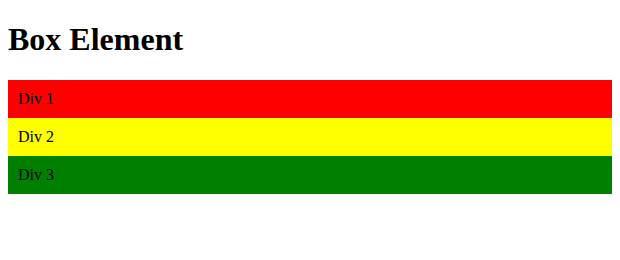

## 1.2 CSS Float Property
Properti `float: left` pada `div` membuat elemen "mengambang" ke kiri, sehingga ketiga `div` tersusun **menyamping** dan lebarnya hanya sebesar isinya.

```css
div {
    float: left;
    padding: 10px;
}
```

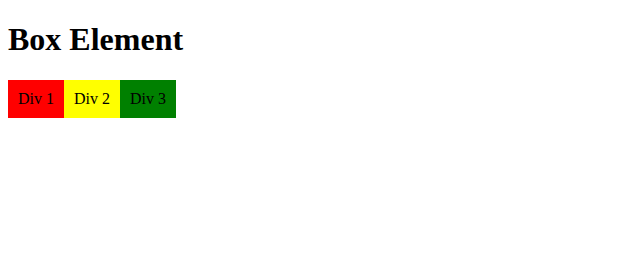

## 1.3 Clearfix (`clear: left`)
`div4` ditambahkan setelah `div3`. Dengan `clear: left` dan `float: none`, `div4` tidak ikut mengambang dan turun ke baris baru di bawah elemen float.

```css
.div4 {
    background-color: blue;
    clear: left;
    float: none;
}
```

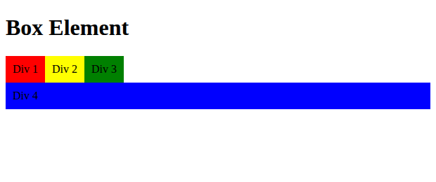

## 1.4 Eksperimen nilai `clear` lainnya

| Nilai | Hasil |
|-------|-------|
| `left` | `div4` turun ke bawah karena `div1–div3` mengambang ke **kiri**. |
| `both` | `div4` turun ke bawah karena membersihkan float di **kiri maupun kanan**. |
| `right` | `div4` **tidak turun**, karena tidak ada elemen yang mengambang ke kanan. `div4` tetap berada di posisi awal dan elemen float menumpuk di atasnya. |

**clear: right**
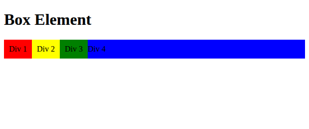

**clear: both**


---

# Bagian 2 — Membuat Layout Sederhana (`lab4_layout`)

## 2.1 Kerangka Layout dengan HTML5 Semantic Elements
Kerangka dibuat dengan elemen semantik `<header>`, `<nav>`, `<section id="hero">`, `<section id="wrapper">` (berisi `<section id="main">` dan `<aside id="sidebar">`), serta `<footer>`. Seluruhnya dibungkus `<div id="container">`.

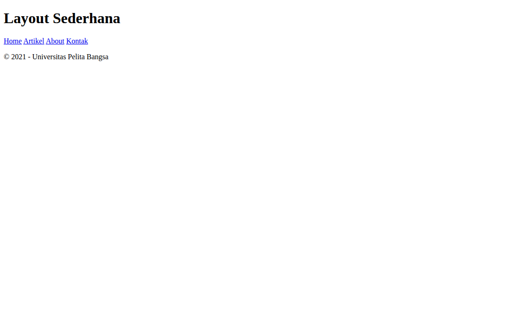

## 2.2 CSS Dasar & Header
Berisi import Google Font, reset CSS (`margin` dan `padding` = 0), gaya `body`, `#container` selebar 980px yang diposisikan di tengah (`margin: 0 auto`) dengan `box-shadow`, serta gaya `header`.

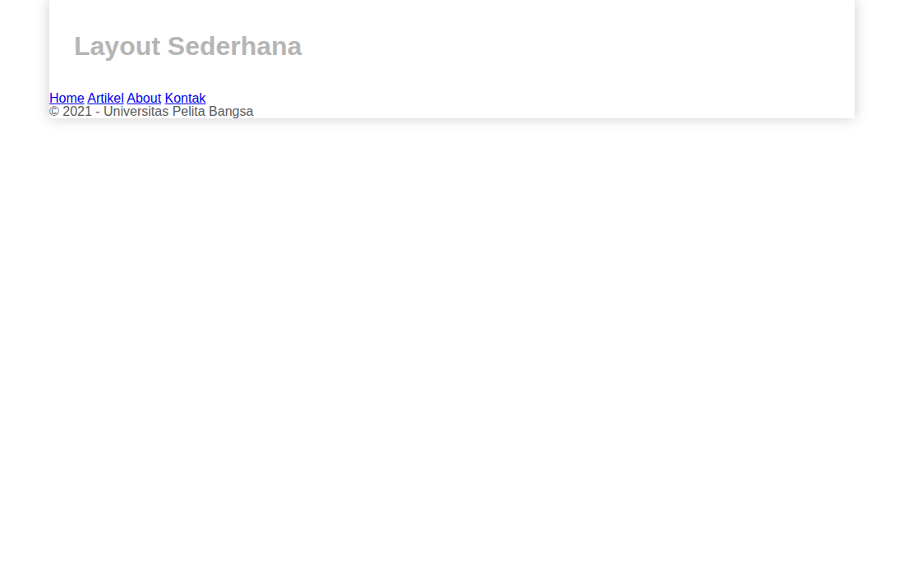

## 2.3 Navigasi
Menu dibuat dari tag `<a>` dengan `display: inline-block` agar tersusun menyamping. Kelas `.active` dan `:hover` memberi warna berbeda.

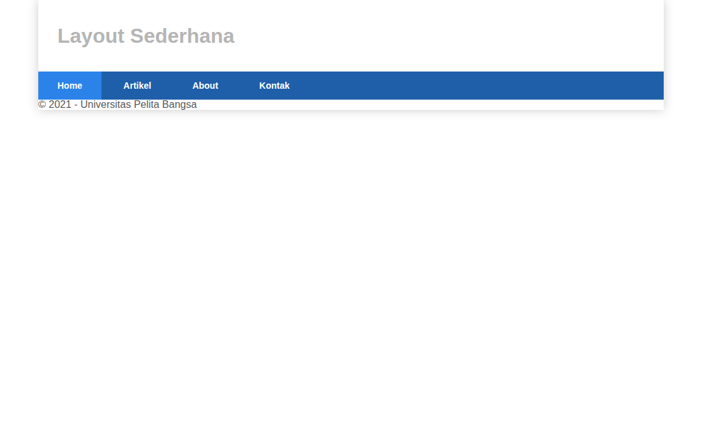

## 2.4 Hero Panel
Berisi judul, paragraf, dan tombol *Learn more*. Latar abu-abu dengan `padding` 50px 20px.

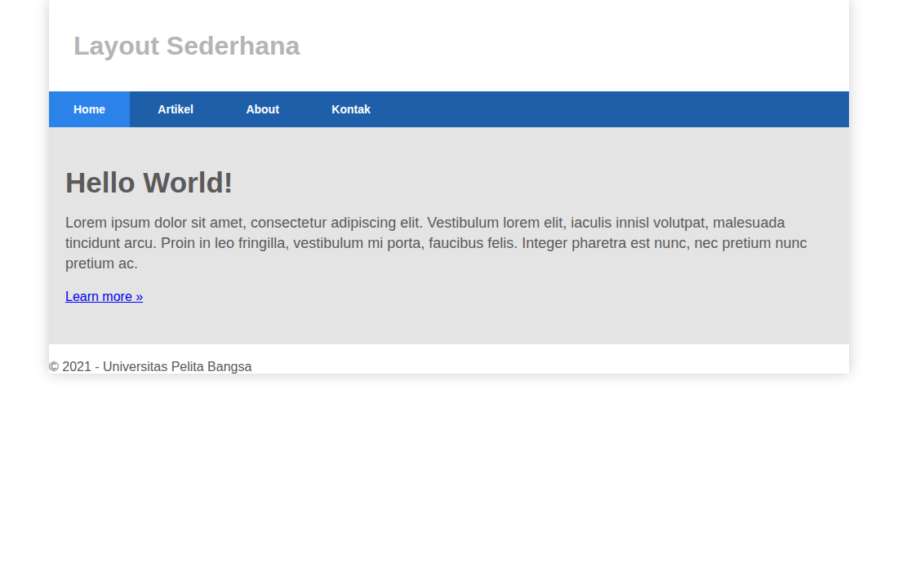

## 2.5 Layout Main dan Sidebar + Sidebar Widget
`#main` (640px) dan `#sidebar` (260px) sama-sama `float: left` sehingga tampil berdampingan (total 980px dengan padding). Sidebar diisi dua `widget-box`: daftar link dan teks.


## 2.6 Footer
`clear: both` dipakai agar footer berada **di bawah** kedua kolom yang mengambang.


## 2.7 Main Content: Box
Tiga `.box` (masing-masing `width: 33.333333%`, `float: left`, `box-sizing: border-box`) berisi lingkaran berwarna 120×120 (div dengan `border-radius: 50%`), heading, teks, dan tombol *View detail*. `.row:after` dengan `clear: both` dipakai sebagai clearfix.

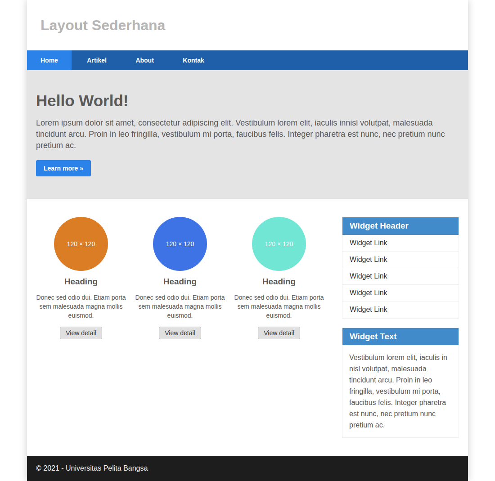

## 2.8 Content Artikel
Dua `<article class="entry">` dipisahkan `<hr class="divider">`. Kotak 150×150 pada artikel pertama mengambang di kiri, pada artikel kedua di kanan (`.right-img`).

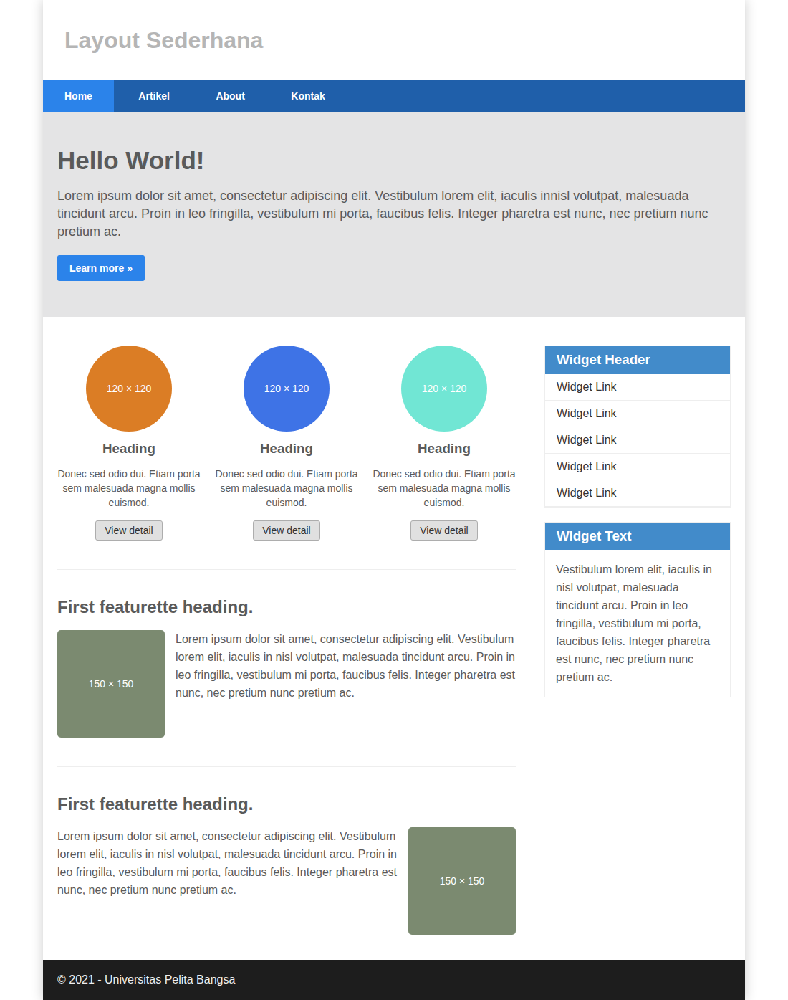

---

# Bagian 3 — Pertanyaan dan Tugas

## Tugas 1: Layout menu About (`about.html`)
Single layout yang berisi **deskripsi** diri, **portfolio** (3 kartu proyek), serta sidebar *Profil Singkat* dan *Keahlian*.

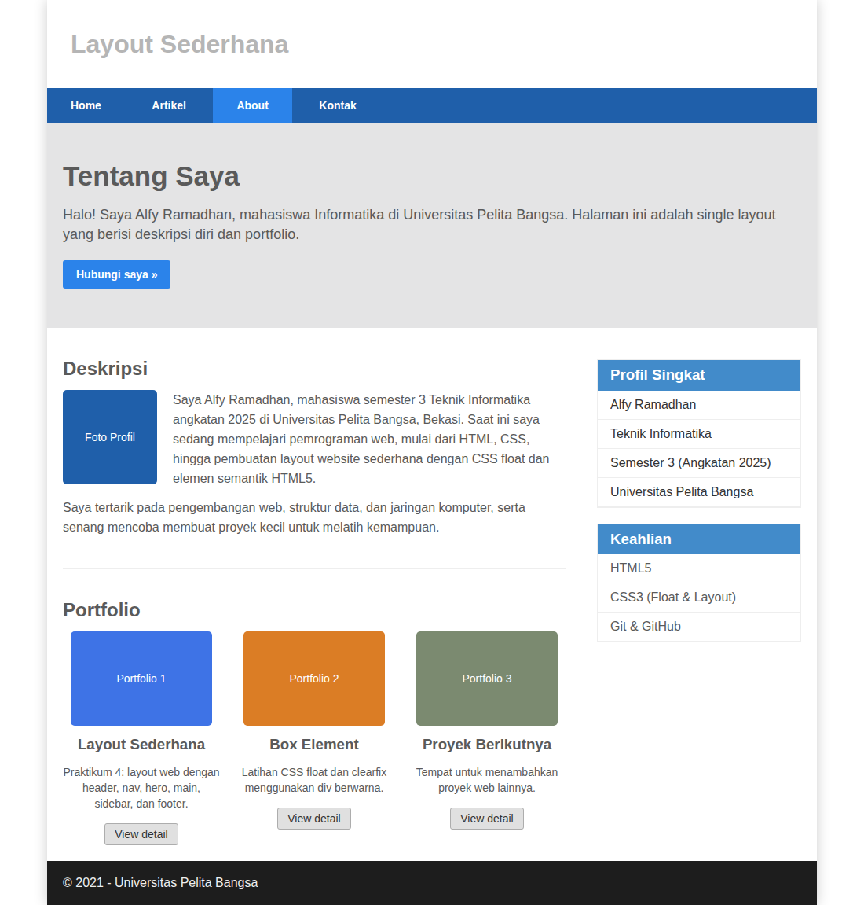

## Tugas 2: Layout menu Contact (`kontak.html`)
Berisi form isian: **nama, email, no. telepon, subjek, message**, tombol *Kirim Pesan* dan *Reset*, serta sidebar informasi kontak.

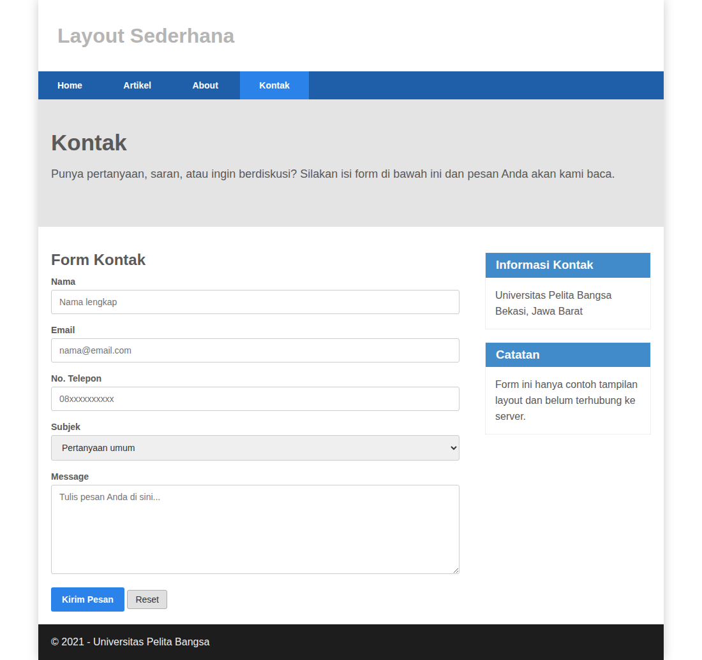